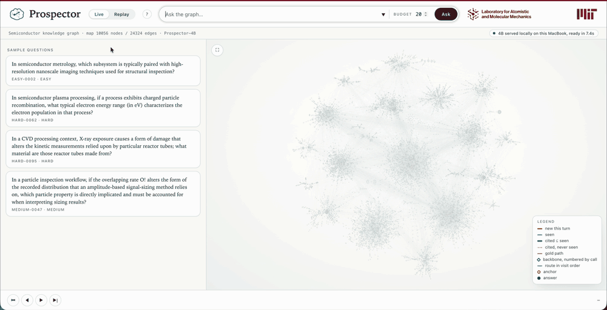

# Prospector

Prospector is a compact LLM policy post-trained to answer questions
over a scientific knowledge graph (KG).
It calls a small set of tools to traverse the graph turn by turn,
building its context from what each call returns,
and answers with a chain of edges that
is checked against what its tools retrieved.

Knowledge in a specialized engineering field is scattered across the
literature and often proprietary, so it can be absent from what off-the-shelf
models are trained on, and their answers there are generic. A knowledge graph
extracted from that literature can ground a model's reasoning, but the usual
LLM + KG system selects a portion of the graph before reasoning begins, deciding what
is relevant before the question has been reasoned about. Prospector decides
its next move as it goes, prospecting for new evidence in light of what it has already found.

Trained on one graph, built from the semiconductor-manufacturing literature,
Prospector approaches the strongest off-the-shelf models given the same graph
and tools, far exceeds them answering closed book or from a pre-selected
portion of the graph, and transfers with frozen weights to graphs from three
other fields: bio-inspired materials, PFAS and materials properties. It
serves on one GPU, faster and cheaper than a hosted service, with the graph
on its owner's hardware.
Furthermore, the latent state reads out Prospector's next move
and can be steered from one behaviour to another.
[Reproducing the paper](#reproducing-the-paper) recomputes each of these from
the stored runs. The weights, the training rows and the stored runs will be
released at `huggingface.co/lamm-mit/Prospector`.

## Contents

- [What Prospector does](#what-prospector-does)
- [Quick start](#quick-start)
- [Setup](#setup)
- [Serving Prospector](#serving-prospector)
- [Adding a graph](#adding-a-graph)
- [Training on your own graph](#training-on-your-own-graph)
- [Probing the latent state](#probing-the-latent-state)
- [Reproducing the paper](#reproducing-the-paper)
- [Developing](#developing)
- [Citation](#citation)

## What Prospector does



*One episode of Prospector-4B on the semiconductor graph, in the app: the question, the tool calls with their observations and the model's reasoning between them, the retrieved subgraph growing on the right, and the final answer with the gate's check of the cited chain.*

A knowledge graph extracted from a field's literature is too large for a
prompt, its relations are free text, and it has no schema. Prospector answers
questions over such a graph by traversing it one tool call at a time. It is
post-trained from Qwen3.5, at 0.8B, 2B and 4B parameters, and sees the graph
only through three tools, which its prompt describes in these words:

```
find(name)                       -> up to 10 nodes whose name matches `name`, with
                                    type and connection count. Returns no edges. Use it
                                    first to get the exact spelling of an entity.
expand(node, relation?, offset?) -> the edges connected to `node` in either direction,
                                    at most 40 per call. `relation` filters, `offset`
                                    pages. A node with more than 150 connections returns
                                    a relation summary instead of edges — narrow first.
connect(a, b, max_hops?)         -> up to 3 shortest paths between two nodes, as
                                    edges. Use it when you already know both ends.
```

The prompt lives in `agent/prompts.py`, and the tool descriptions in it are
written in `agent/tools.py` with each run's limits filled in. The episode
loop in `agent/loop.py` records every edge a tool returns as seen, and the
model ends with an answer and the chain of edges that supports it. The gate
in `agent/gate.py` accepts that answer only if it cites at least one edge,
every cited edge was seen, and it names a node of the cited chain: set
membership, with no judge. `agent/metrics.py` scores the paper's metric,
gated success. An answer counts when the gate accepts it and its text, from
`ANSWER:` to the end of the final turn, names a gold label; when that text
says "the answer is", only what follows the last one is matched. Names are
compared after Unicode, case and whitespace normalization. Every results row
carries that verdict as the field `gated_acc`, and a run's gated success is
the fraction of its questions that count.

Prospector-4B is fine-tuned from `Qwen/Qwen3.5-4B`,
with three LoRA adapters applied in order, trained by the recipe under
[Training on your own graph](#training-on-your-own-graph). The 0.8B and the
2B are built the same way; [configs/README.md](configs/README.md) names each
size's stack.

## Quick start

On a Mac with Apple silicon, or on a Linux machine with an NVIDIA GPU such
as an H100 or a GH200.

```bash
# install uv, unless you have it
curl -LsSf https://astral.sh/uv/install.sh | sh
export PATH="$HOME/.local/bin:$PATH"
git clone https://github.com/lamm-mit/Prospector && cd Prospector
# download the adapters and the data, about 9 GB
uvx --from huggingface_hub hf download lamm-mit/Prospector --local-dir . \
    --include "models/*" --include "data/*"
# build the environment and evaluate Prospector-4B on six questions
./quickstart.sh
```

`quickstart.sh` builds the machine's environment and evaluates Prospector-4B
on two questions per difficulty tier, printing the same table as the paper's
runs: a check that the install works, not a measurement
([Reproducing the paper](#reproducing-the-paper) is). On a Mac it builds
`.venv-mac` and evaluates through the `mlx:` driver; the paper's numbers
were read through the `vllm:` driver, and the two can answer a question
differently. On a GPU machine it runs `launch/setup.sh`, which installs the
stack pinned in `launch/constraints-gpu.txt`, CUDA's compiler from NVIDIA's
repository (which needs `sudo`) and Qwen3.5's two kernels, in about ten
minutes on a fresh machine, and evaluates through the `vllm:` driver. The
script prints every command before it runs it, stops before building
anything when the adapters are missing, and ends by naming the environment
to activate. The first run fetches the base model `Qwen/Qwen3.5-4B` from the
Hub (about 9 GB, into `~/.cache/huggingface`) and merges the three adapters
into one model (about 8 GB, written inside the last adapter's directory
under `models/`), which takes a few minutes;
allow about 27 GB of disk in all. After that first run the evaluation and the
app work offline (`HF_HUB_OFFLINE=1`). On a Mac the first run peaked at 18 GB
of memory; 24 GB is what it was run on.

With that environment active, the app serves the same model:

```bash
python -m uvicorn app.server:app --port 8321
```

Open `http://localhost:8321`. Its live mode runs Prospector-4B on a question
you pick from the benchmark or type yourself. The app listens on the machine
itself only, so for a remote GPU machine, run
`ssh -L 8321:localhost:8321 <machine>` on your own computer first.
[Setup](#setup) lists every environment, and
[Serving Prospector](#serving-prospector) the evaluation's options.

## Setup

Each machine has one environment. A Mac has a second one for mlx.

| venv | extras | where | for |
|---|---|---|---|
| `.venv` | `.[dev]`, and `.[app]` for replay | anywhere | the fast suite, the API models, the data builders, replay in the app |
| `.venv` | `.[dev,train,rl,app]`, built by `launch/setup.sh` | a Linux CUDA machine | the trainers, the `vllm:` driver, `prospector` and the live app |
| `.venv-mac` | `.[dev,train,mlx,app]` | Apple silicon, macOS 14 or later, Python 3.12 | the `mlx:` driver, the live app, the torch-dependent tests |

```bash
uv venv --python 3.12 .venv && uv pip install --python .venv/bin/python -e ".[dev]"   # ".[dev,app]" for replay
uv venv --python 3.12 .venv-mac && uv pip install --python .venv-mac/bin/python \
    -e ".[dev,train,mlx,app]" -c launch/constraints-mac.txt
cp .env.example .env        # OPENAI_API_KEY and OPENROUTER_API_KEY, for the API models
source .venv/bin/activate   # every command below runs in the active environment
python -m pytest            # the suite, no GPU or API key
```

Tests that need torch, a cached tokenizer, the app extras or a graph skip
without them. `launch/setup.sh` prepares a GPU machine: it builds `.venv`
with the training extras and Qwen3.5's two kernels.
[launch/README.md](launch/README.md) gives the steps by hand and what to copy
off a rented machine before it is terminated.

## Serving Prospector

**The release.** The repository holds the code and the questions. The graphs
come from their sources; [data/raw/README.md](data/raw/README.md) fetches the
four graphs with their checksums. The adapters, the training rows and the
stored runs will be released at `huggingface.co/lamm-mit/Prospector`, laid
out as this repository is. Unpack the release at the repository root, so
that the adapters (18 directories) land under `models/`, the rows under
`data/traj/` and the runs under `data/runs/`.

**An evaluation run.** `scripts/run_agent_eval.py` is the evaluation entry
point for every model. It evaluates an API model by name, or local weights through the
`hf:`, `vllm:` or `mlx:` driver; `--adapter` names a comma-separated chain
of LoRA adapters. These two commands evaluate Prospector-4B on the
semiconductor graph, from a CUDA machine and from a Mac:

```bash
STACK=models/traj_sft_4b_flash20g2/final,\
models/traj_grpo_4b_flash20d1/checkpoint-120,\
models/traj_grpo_4b_flash20d2/checkpoint-120
python scripts/run_agent_eval.py --graph tsmc --model vllm:Qwen/Qwen3.5-4B --adapter $STACK \
    --turn-max-tokens 1024 --seed 0 --name 4b-s0
python scripts/run_agent_eval.py --graph tsmc --model mlx:Qwen/Qwen3.5-4B --adapter $STACK \
    --turn-max-tokens 1024 --name 4b-mac                     # in .venv-mac
```

A run writes `data/runs/<name>--<benchmark>/`: `results.jsonl` (the
per-question metrics), `trajectories.jsonl` (every transcript with its seen
set), `summary.json` (the settings and the aggregates) and `latency/`
(fifteen questions answered one at a time, the run's latency; `--no-latency`
skips it). These flags set the conditions of a run:

- `--turn-max-tokens`: the tokens a turn may generate, 1,024 by default and
  the budget behind every policy number in the paper. At 512 the policies'
  final answers are truncated.
- `--max-turns`: 20 in every reported run. The policy conditions its search
  on the announced budget, so a different value is a different policy.
- `--limit N`: the first N questions of each difficulty tier, for a cheap
  trial. A question's tier is the length of its gold path through the graph:
  easy, medium and hard for two, three and four hops.
- `--temperature` samples instead of decoding greedily; `--seed` seeds each
  item's tool RNG and a local driver's sampler.
- `--tools`: the tools offered, by default all three (`find,expand,connect`).
  `--tools find,expand` withholds `connect`: the prompt no longer describes
  it, and if the model calls it anyway the harness refuses the call, which
  still uses up one of the 20 calls.
- `--benchmark` and `--kb`: another question file and graph
  ([Adding a graph](#adding-a-graph)).

Greedy decoding differs between runs on this model family, so compare
replicated runs. The recipe's stage evaluations use `--seed 0`, `1` and `2`.

The three local drivers serve the same weights under the same prompt and
template; they differ by machine, and `vllm:` and `mlx:` cut a conversation
at the context window (`--max-model-len`) where `hf:` does not. The paper's
policy numbers come from the `vllm:` driver. Every adapter's `run.json` records its chat template, the
recipe's `plain_chatml`, and the drivers install it; no command names it.
`--chat-template` serves a base model or a foreign adapter that records
none, and with an adapter that records one, the flag must agree with the
record.

| driver | engine | machine | used for |
|---|---|---|---|
| `vllm:` | vLLM, batched | a Linux CUDA machine (`.venv`) | the recipe's evaluations, its decision-state sampling and GRPO rollouts; the paper's numbers |
| `mlx:` | mlx-lm on Metal | Apple silicon (`.venv-mac`) | evaluations on a Mac and the live app |
| `hf:` | transformers `generate`, no engine | CUDA, Apple `mps` or CPU | a machine with neither engine, and the verifier's scorer |

The vLLM and Mac drivers merge the adapters into one model on their first
run, save it inside the last adapter's directory and reuse it afterwards; the plain
transformers driver merges them in memory each time. The drivers choose
their own device, precision and batching; `eval/local_model.py` documents the
four environment variables that override them.

**An API model in the same harness.** The same script evaluates any
OpenAI-compatible model through the same loop, tools and gate. Give the
model's name to `--model` in place of a local driver. An OpenAI model, named
by its plain id such as gpt-6-astra, runs against OpenAI. Any other model,
named with its vendor prefix such as google/gemini-3.7-flash, goes through
OpenRouter. The two API keys are read from `.env`, never from the command
line. Setting `OPENAI_BASE_URL` sends every model to that address instead,
for a server of your own.

Each command below runs five questions per tier, enough to price a full pass:

```bash
# an OpenAI model
python scripts/run_agent_eval.py --graph tsmc --model gpt-6-astra \
    --prompt-version agent_v1_label --turn-max-tokens 512 --limit 5 --name gpt6astra-probe
# another vendor's model, through OpenRouter
python scripts/run_agent_eval.py --graph tsmc --model google/gemini-3.7-flash --limit 5 \
    --name gemini37flash-probe
# an OpenAI model through OpenAI's function-calling channel
python scripts/run_agent_eval.py --graph tsmc --model gpt-5.6-sol \
    --prompt-version agent_v1_label_native --tool-protocol native-responses \
    --turn-max-tokens 3000 --limit 5 --name gpt56sol-native-probe
```

A hosted model differs from a policy run in four respects:

- A reasoning model spends the turn budget on its hidden reasoning before it
  writes a call. When turns come back empty, the run ends with a warning;
  the fix is a larger `--turn-max-tokens`, 3,000 or more.
- `--prompt-version` selects the prompt; the policy's `agent_v1` is the
  default. The paper's API arms use `agent_v1_label`, which adds the rule
  that the answer entity is named exactly as its node label reads.
  Anthropic models take `agent_v1_label_nothink`, the same prompt without
  the visible reasoning block.
- By default a model calls a tool by writing
  `<tool_call>{"tool": ..., "args": ...}</tool_call>` into its reply, which
  the loop parses. This is the text protocol, the one Prospector is trained
  on. An OpenAI model that cannot keep to it, such as gpt-5.6-sol, uses
  OpenAI's function-calling channel instead, with
  `--tool-protocol native-responses` and the prompt `agent_v1_label_native`.
  The loop writes each call the channel returns into the same block, so the
  gate reads both alike.
- Responses are cached under `data/cache/` by model, messages and
  parameters, so a rerun is free and identical. `--no-cache` makes a rerun a
  fresh draw. `--concurrency` bounds the calls in flight, and
  `--api-timeout` each call.

**The app.**

```bash
# live and replay in .venv-mac or a GPU machine's .venv
python -m uvicorn app.server:app --port 8321
```

Open `http://localhost:8321`. Live, the default mode, serves Prospector-4B
through the `mlx:` driver on a Mac or the `vllm:` driver on a GPU machine. It
runs a fresh episode on a benchmark question, graded against its gold
answer, or on a question of your own, checked by the gate alone. Opening the
address starts the model's load; `http://localhost:8321/#replay` opens
replay without one. In a `.venv` with only `.[dev,app]`, replay mode works
and live mode reports the missing engine. Replay steps through the stored
runs under `data/runs/` that carry trajectories (the agentic runs), with the transcript,
the seen subgraph growing call by call and the citation check drawn at the
end.
[app/README.md](app/README.md) describes the design and the overrides.

## Adding a graph

To add a new graph, edit the following three places:

1. **The graph file**, under `data/raw/<name>/`: a directed GraphML whose
   edges carry a `relation` attribute, the format of the GraphAgents graphs.
   The paper's four graphs were extracted from papers by the generative
   pipeline at `github.com/lamm-mit/GraphReasoning`.
2. **A substrate**, a folder under `src/graph_reasoner/substrates/<name>/`,
   which is how the package knows the graph. Its `backend.py` registers the
   name and the default file and names the class that loads it; the package
   imports every folder there, so nothing else is edited. Copy
   `substrates/pfas/`, three short files. For a GraphAgents-format
   file the backend is a subclass of `GraphAgentsBackend` that sets its
   name; for another layout, write a loader on `PairIndexedBackend` in
   `substrates/_graphml.py`, as `substrates/biograph/` does. The third file,
   `qa_style.py`, is the teacher persona, read only when questions are
   generated.
3. **Questions**, under `data/benchmarks/<name>/`, built from a copy of
   `configs/benchmark/pfas_v0.yaml` as
   [Training on your own graph](#training-on-your-own-graph) shows. The
   evaluation reads them, and the app finds a graph's substrate through its
   question file.

Then `--graph <name>` on the evaluation command serves the released policy
on your graph without retraining, and `GR_LIVE_BENCHMARK` points the app's
live mode at the questions, with `GR_LIVE_KB` for another file of the same
format. The paper's transfer results were run that way.

## Training on your own graph

**The questions.** A question is built from its answer: the generator
samples a gold path through the graph, and a teacher model phrases a question
whose answer is the path's end, so no annotation and no judge are needed.
Copy `configs/benchmark/pfas_v0.yaml`, set `kg_path`, `substrate`, `output`
and `teacher_model` (whose key is read from `.env`), and run the three steps
below. `--offline` writes template questions without an API call, for a
first check of the plumbing:

```bash
# 1. sample gold paths through the graph; the config's teacher model phrases a question for each
python scripts/bench/build_benchmark.py --config configs/benchmark/<kg>_v0.yaml \
    --out data/benchmarks/<kg>/<kg>_v0.jsonl
# 2. drop unusable questions, such as one that names its own answer or neither end of its
#    path; each dropped question goes to <kg>_core.dropped.jsonl with its reason
python scripts/bench/curate_core.py --benchmark data/benchmarks/<kg>/<kg>_v0.jsonl \
    --out data/benchmarks/<kg>/<kg>_core.jsonl
# 3. add each question's anchor entity and every answer its gold relations reach in the
#    graph, the answer set the gate scores against
python scripts/bench/augment_agentic.py --benchmark data/benchmarks/<kg>/<kg>_core.jsonl \
    --out data/benchmarks/<kg>/<kg>_core_agentic.jsonl
```

A training pool is a second, larger build, augmented with
`--source <kg>/train --exclude data/benchmarks/<kg>/<kg>_core_agentic.jsonl`
so that no evaluation gold path enters it. `scripts/bench/merge_train.py`
joins batches. The pool goes to `data/benchmarks/<kg>/<kg>_train_agentic.jsonl`,
the file `prospector teach` and `prospector run` read; a substrate names
another with `train_benchmark=` in its `register_backend` call. [data/benchmarks/README.md](data/benchmarks/README.md)
describes the files.

**The teacher pass.** The stages start from demonstrations: the correct,
gate-passing episodes of a frontier teacher, `gemini-3.7-flash`, on the
training questions. The package installs one command, `prospector`, and
`prospector teach` runs the pass on your own machine, with the API key in
`.env`. It runs the pieces it is given, in order: one of the pass's eight
shards, `0` to `7`, or one of the three steps that close it, `ids`, `p2`
and `mix`. Each step refuses to start until the one before it has run:

```bash
# shard 0 first: its usage line prices the other seven
prospector teach --graph tsmc 0
# the other seven; a shard whose run exists is skipped
prospector teach --graph tsmc 1 2 3 4 5 6 7
# ids: the first pass's rows, and the questions with no correct, gate-passing episode
# p2: a second, uncached pass over those questions
# mix: the rows of all nine runs, plus at most one synthetic detour per episode (an
#   expansion of an off-path node spliced in, and the turn that leaves the dead end),
#   blended into data/traj/tsmc_sft_mix_flash20.jsonl, the demonstrations stage 1 trains on
prospector teach --graph tsmc ids p2 mix
```

Use `--tag` to name the pass's data files; every file downstream inherits the name:

```bash
# a pass by another model; shards 1 to 7, ids, p2 and mix take --tag astra alone
prospector teach --graph tsmc --teacher gpt-6-astra --tag astra 0
# the stages on that pass, given the same tag
nohup prospector run --graph tsmc --size 4b --tag astra > logs/q4bastra_run.log 2>&1 &
```

<p align="center"></p>

*Figure 4A of the paper: the stages of the recipe in order. Stages 1 and 3 train from the base model. Stage 4 continues stage 3 and is served as trained; its return arrow marks that its states are rebuilt whenever the policy changes. The verifier branches off the served policy.*

**The recipe.** The recipe is four training stages on one GPU and a
verifier that selects among 32 sampled answers, built from the teacher
pass's demonstrations:

| stage | what it does | hyperparameters | script |
|---|---|---|---|
| 1 | SFT from the base model on the demonstrations | `configs/sft1.yaml` | `scripts/train_sft.py --stage sft1` |
| 2 | GRPO on whole episodes of the medium and hard training questions | `configs/grpo_full.yaml` | `scripts/train_traj_grpo.py --stage full` |
| 3 | SFT from the base model on the demonstrations plus stage 2's correct, gate-passing episodes | `configs/sft2.yaml` | `scripts/train_sft.py --stage sft2` |
| 4 | two GRPO rounds, each restarting the policy's own episodes from a decision point | `configs/grpo_decision.yaml` | `scripts/train_traj_grpo.py --stage d1`, `--stage d2` |
| selection | a yes/no verifier, trained on the policy's gate-passing answers, picks one of 32 sampled answers | `configs/verifier.yaml` | `scripts/train_sft.py --stage verifier`, `scripts/select/verifier_select.py` |

An episode earns a reward of 1 when its answer is correct and the gate
accepts its chain, and otherwise a quarter of the fraction of the gold path's
edges its calls returned. Both GRPO stages train only where the policy's
samples differ: on the questions, or stage 4's decision points, that its
samples solve between 5% and 95% of the time. A decision point is one of the
policy's own episodes cut just before its final answer, when the episode had
already retrieved the answer, or else just after the call that first returned
a node one hop from the answer. After each supervised stage, the recipe evaluates
the policy on three seeds and compares the mean with a floor of 0.40, with at
least eleven tool calls an episode on average. After each GRPO round it
evaluates every checkpoint and picks one.
[src/graph_reasoner/recipe/README.md](src/graph_reasoner/recipe/README.md)
calls the floored evaluation a *gate*, which is not the citation gate above, and
defines the recipe's other words: the *grid* over a round's checkpoints, the
*pick* among them, and the *coda* beyond a stage's evaluation.

`prospector run` runs the recipe for one graph and one model size. A file
under `configs/` holds one stage's hyperparameters. `graph_reasoner.recipe`
derives every file a stage reads or writes, and every run name, from `--graph`, `--size` and `--tag`. Each
adapter directory records what it was trained from in `run.json`. A stage
whose outputs exist is skipped, so a relaunch resumes. A run that finds the
released adapters trains nothing. It skips the stored evaluations it finds
and runs the rest.
`prospector plan` prints what a run would do, and `--help` the flags:

```bash
# stages 1 to 4 and the selection, on the GPU machine: days on one card
nohup prospector run --graph tsmc --size 4b --transfer-graph biograph \
    > logs/q4b_run.log 2>&1 &
```

GRPO needs one CUDA GPU with 80
to 96 GB of memory ([launch/README.md](launch/README.md)).
[src/graph_reasoner/recipe/README.md](src/graph_reasoner/recipe/README.md)
describes the stages and what a relaunch skips.
[configs/README.md](configs/README.md) describes the five hyperparameter
files, what a run records and the served stacks.

**The flags.** Every file and run name is derived from the first four;
`prospector names --graph <kg> --size <size> --env` prints the names:

| what it sets | flag |
|---|---|
| the graph: its file, its evaluation and training questions, as its substrate declares them | `--graph` |
| the base model | `--size` (`0.8b`, `2b` and `4b` imply `Qwen/Qwen3.5-<size>`; another size adds `--model`) |
| the teacher pass the stages are built from, which names every file | `--tag` (`flash20` unless set) |
| the transfer graph evaluated after every stage | `--transfer-graph` (none unless set; the paper's is `biograph`) |
| a stage's hyperparameters | `--config FILE` on `scripts/train_sft.py` or `scripts/train_traj_grpo.py`, in place of the stage's file under `configs/` |

## Probing the latent state

<p align="center"></p>

*Figure 6A of the paper: latent states at the start of a turn, colored by the move taken next, in the plane that separates the three moves on the semiconductor graph, at three layers; the bio-inspired-materials graph's states are projected onto the same plane, and the arrows mark one dose unit of each steering direction.*

After every observation, before the policy writes its next turn, its latent
state already carries the move it is about to make: follow a node on the
page just seen, backtrack to a node from an earlier page, or answer. A
linear reading of one layer separates the moves; fitted on one graph, it
applies unchanged to another. A vector added to that layer while the policy
generates shifts the mix of moves it makes. `prospector latent` runs the probe on the CUDA machine
against the served stack, in six stages under `data/runs/_probe/`. The first
four are skipped when their outputs exist, `steer` skips each arm whose run
is finished, and `mix` tabulates every arm again:

- `states`: one teacher-forced pass over each of two stored runs, on the
  training graph and on a transfer graph, keeping the residual stream after
  every layer at the position where each turn begins;
- `moves`: the move taken after every observation, read from the stored
  transcripts;
- `readings`: the two readings, following against backtracking and
  answering against continuing, fitted at every layer on the training
  graph's states and scored on the transfer graph's, as the profile
  `depth_profile.json`;
- `directions`: the follow and answer axes at one layer, with the dose unit
  of each and random directions as controls;
- `steer`: the ordinary evaluation through the served policy with a vector
  added at that layer, one arm per direction and dose, at several episode
  seeds;
- `mix`: every arm's move shares, calls and accuracy, in a `mix.json` for each
  seed's folder of arms (`knob_vllm` for seed 0, `knob_vllm_r2` and
  `knob_vllm_r3` for seeds 2 and 3).

The modules are under `src/graph_reasoner/latent/` and the stage scripts
under `scripts/latent/`. The command with the paper's runs is under
[Reproducing the paper](#reproducing-the-paper).

## Reproducing the paper

Every number in the paper comes from a stored run under `data/runs/`. Each
command below is followed by the number it prints, the paper's value and the
stored runs behind it. The timing runs behind the cost figure are stored too,
priced by `data/analysis/inference_speed.json`.

An evaluation prints a table when it ends, one row per difficulty tier and
an `ALL` row, and writes the same aggregates to `summary.json` in the run's
directory. The headline column is `acc`, the field `gated_acc` of every
results file: the paper's gated success. Greedy decoding differs between
runs, so a rerun does not reproduce a stored run question by question. The
paper averages eight seeds for the policy on its training graph and three
on each unseen graph. The seeds scatter with standard deviations of 0.011 to
0.022, so a single run within about 0.04 of the paper's mean reproduces it.
The API runs and the baselines run from `.venv` and spend API credit.

### 1. Prospector

The vote and the verifier's pick over the stored pool of 32 sampled answers,
from the release's files, no GPU:

```bash
# the majority vote, 0.856, and the share of questions some sample answered, 0.985;
# --scores adds the verifier's pick over the same pool, 0.913
python scripts/select/best_of_n.py data/runs/flash20pool34-s{101..132}--tsmc_core_agentic \
    --scores data/runs/flash20-verifier32-yn1a3--tsmc_core_agentic
```

Sample a new pool of 32 and have the verifier choose, on a GPU machine:

```bash
prospector run --graph tsmc --size 4b --start-at final
```

Evaluate Prospector without the verifier, on the semiconductor graph and
zero-shot on the three unseen graphs:

```bash
STACK=models/traj_sft_4b_flash20g2/final,\
models/traj_grpo_4b_flash20d1/checkpoint-120,\
models/traj_grpo_4b_flash20d2/checkpoint-120
# the semiconductor graph; the paper averages --seed 0 to 7 (the 2B's and 0.8B's
# stacks are in configs/README.md)
python scripts/run_agent_eval.py --graph tsmc --model vllm:Qwen/Qwen3.5-4B --adapter $STACK \
    --turn-max-tokens 1024 --seed 0 --name 4b-s0
# the base model in the same harness, under the policy's template; the paper averages --seed 0 to 2
python scripts/run_agent_eval.py --graph tsmc --model vllm:Qwen/Qwen3.5-4B --chat-template plain_chatml \
    --turn-max-tokens 1024 --seed 0 --name base4b-s0
# the three unseen graphs; the paper averages --seed 0 to 2
python scripts/run_agent_eval.py --graph biograph --model vllm:Qwen/Qwen3.5-4B --adapter $STACK \
    --turn-max-tokens 1024 --seed 0 --name 4bbio-s0
python scripts/run_agent_eval.py --graph pfas --model vllm:Qwen/Qwen3.5-4B --adapter $STACK \
    --turn-max-tokens 1024 --seed 0 --name 4bpfas-s0
python scripts/run_agent_eval.py --graph matprop --model vllm:Qwen/Qwen3.5-4B --adapter $STACK \
    --turn-max-tokens 1024 --seed 0 --name 4bmat-s0
```

The paper's values:

| value | `gated_acc` | runs |
|---|---|---|
| Prospector-4B on the semiconductor graph | 0.839 ± 0.015 | `flash20cap1024-s0` to `-s7` |
| Prospector-2B | 0.755 ± 0.016 | `q2bd2eval-ck120-s0` to `-s7` |
| Prospector-0.8B | 0.694 ± 0.021 | `q0.8bd2eval-ck120-s0` to `-s7` |
| the base model, Qwen3.5-4B, in the same harness | 0.039 ± 0.008 | `base4b1k-agent-s0` to `-s2` |
| the 4B on bio-inspired materials | 0.803 ± 0.017 | `flash20stackbio-s0` to `-s2` |
| the 4B on PFAS | 0.766 ± 0.022 | `stack1kpfas-ctx32k-s0` to `-s2` |
| the 4B on materials properties | 0.809 ± 0.011 | `stack1kmatprop-s0` to `-s2` |

Each run named in this section is a folder under `data/runs/` in the
release, `<run>--<question file>`. Its `summary.json` holds that run's
number, and the app's replay mode opens it.

`prospector run` ends by printing `gated_acc` stage by stage, each over
the seeds it evaluated:

| after stage | 0.8B | 2B | 4B | runs (`<size>` is `0.8b` or `2b`) |
|---|---|---|---|---|
| 1 | 0.487 | 0.622 | 0.711 | `q<size>sft1eval-s0` to `-s2`; the 4B's `gen1sft1k-s0` to `-s2` |
| 2 | 0.626 | 0.691 | 0.752 | `q0.8bfulleval-ck40-s*`, `q2bfulleval-ck100-s*`; `full1k-s0` to `-s2` |
| 3 | 0.638 | 0.687 | 0.790 | `q<size>g2eval-s0` to `-s2`; `gen2sft1k-s0` to `-s2` |
| 4 | 0.694 | 0.755 | 0.839 | the rows of the table above |
| the verifier's pick of 32 | 0.862 | 0.882 | 0.913 | `q<size>-verifier32-yn1`; `flash20-verifier32-yn1a3` |

At 0.8B and 2B the run reads the stored runs, which carry the names the
recipe derives; the 4B's stored runs carry older names, so at 4B the run
evaluates afresh under the `q4b` names. The same run prints the majority vote
over the 32, 0.856 for the 4B, and the share of questions some sample
answered, 0.985. The paper's split of the misses by cause (Figure 4B) is
`scripts/analysis/diagnose_miss_buckets.py` over three seeds:

```bash
python scripts/analysis/diagnose_miss_buckets.py data/runs/flash20cap1024-s{0..2}--tsmc_core_agentic
```

### 2. Frontier models through the API

The frontier models run as [an API model in the same harness](#serving-prospector)
describes. `--no-cache` makes a repeated run a fresh draw, and the `-rerun`
names keep it from overwriting the stored run of the same name.

```bash
python scripts/run_agent_eval.py --graph tsmc --model gpt-6-astra --tools find,expand,connect \
    --prompt-version agent_v1_label --turn-max-tokens 512 --no-cache \
    --name gpt6astra-agent-t20-label-rerun
python scripts/run_agent_eval.py --graph tsmc --model gpt-5.6-sol --tools find,expand,connect \
    --prompt-version agent_v1_label_native --tool-protocol native-responses \
    --turn-max-tokens 3000 --no-cache --name gpt56sol-agent-t20-3tool-native-rerun
```

The second command uses OpenAI's function-calling channel, for the two
models that fail the text protocol, gpt-5.6-sol and gpt-5-mini.

Anthropic models take `agent_v1_label_nothink`, the label prompt without
the visible reasoning block. The other three graphs are `--graph biograph`,
`pfas` and `matprop`.

For comparison, the paper's stored runs give:

| model | `gated_acc` | run |
|---|---|---|
| gpt-6-astra | 0.877 | `gpt6astra-agent-t20-label` |
| gpt-5.6-sol, through the function-calling channel | 0.785 | `gpt56sol-agent-t20-3tool-native` |

### 3. Closed-book and retrieved-subgraph baselines

The two baselines answer the same questions with different evidence, one API
call per question: none for closed book, a fixed retrieved subgraph for
retrieval. The retrieved subgraph starts from the question's entity, which
the baseline is given while Prospector has to find it, and keeps the 400
edges one of two rules ranks highest: `khop`, by hop distance from the
entity, or `ppr`, personalized PageRank. Each
graph gets the rule whose 400 edges contain the whole gold chain more often:
`khop` on the semiconductor graph and `ppr` on the other three.

```bash
# 1. the closed-book file: the evaluation questions with no graph evidence
python scripts/arms/build_closed_book.py data/benchmarks/tsmc/tsmc_core_agentic.jsonl
# 2. the retrieval file: each question with the 400 edges a k-hop search from its entity
#    reaches first
python scripts/arms/build_retrieval_benchmark.py --graph tsmc --rule khop --budget 400
# 3. answer each file with one API call per question; --label adds the rule that the answer
#    is named exactly as its node label reads
python scripts/arms/run_static_api.py --model gpt-6-astra \
    --benchmark data/benchmarks/tsmc/tsmc_core__closed_book.jsonl --name gpt6astra-cb-rerun
python scripts/arms/run_static_api.py --model gpt-6-astra --label \
    --benchmark data/benchmarks/tsmc/tsmc_core__khop400anchor.jsonl \
    --name gpt6astra-raganchor-label-rerun
# 4. score both runs with the same gate and answer check as the tool-using runs
python scripts/arms/score_static_gated.py data/runs/gpt6astra-cb-rerun--tsmc_core__closed_book
python scripts/arms/score_static_gated.py \
    data/runs/gpt6astra-raganchor-label-rerun--tsmc_core__khop400anchor
```

`score_static_gated.py` prints the tier table with `em_claim` and
`gated_acc` columns. Closed book shows the model no edge, so nothing can be
cited and its number is `em_claim`; retrieval is scored by the gate like
every other arm. `gpt-6-astra` under the three conditions, from the runs
`gpt6astra-cb2`, `gpt6astra-raganchor-label` and `gpt6astra-agent-t20-label`
on the semiconductor graph and `gpt6astra-closedbook-biograph`,
`gpt6astra-raganchor-label-biograph` and `gpt6astra-agent-biograph-label` on
bio-inspired materials:

| `gpt-6-astra` | closed book | retrieved subgraph | the three tools |
|---|---|---|---|
| semiconductor graph | 0.210 | 0.477 | 0.877 |
| bio-inspired materials | 0.176 | 0.681 | 0.857 |

`--label` adds the label rule to the retrieval prompt; `--no-think` serves
Anthropic models, and `--max-tokens 16000` the models whose reasoning exceeds
the default of 3,000 tokens. On the bio-inspired-materials graph, the same
steps start from these two files:

```bash
python scripts/arms/build_closed_book.py data/benchmarks/biograph/biograph_core_agentic.jsonl
python scripts/arms/build_retrieval_benchmark.py --graph biograph --rule ppr --budget 400
```

### 4. The latent state

The probe described under [Probing the latent state](#probing-the-latent-state),
run against the served 4B stack on the two stored runs the paper used, one
on each graph:

```bash
# the readings: hidden states, the move after every observation, each reading's accuracy
# at every layer, and the two steering directions
nohup prospector latent --graph tsmc --size 4b --transfer-graph biograph \
    --home-run flash20cap1024-s0 --bio-run flash20stackbio-s0 --stop-after directions \
    > logs/latent_readings.log 2>&1 < /dev/null &
# the steering: evaluation runs with a vector added along each direction, at several doses
# and three episode seeds, then each arm's move mix; needs the first command's directions
nohup prospector latent --graph tsmc --size 4b --transfer-graph biograph \
    --home-run flash20cap1024-s0 --bio-run flash20stackbio-s0 --start-at steer \
    > logs/latent_steering.log 2>&1 < /dev/null &
```

The results land under `data/runs/_probe/`. The release leaves out the
hidden states, about 1.7 GB a run, which the `states` stage regenerates.
The paper's figure reads the results through `graph_reasoner.latent.figure`.
The `readings` stage writes the AUC of the two readings at every layer to
`depth_profile.json`, and the `mix` stage each steering arm's move shares to
its seed's `mix.json`. The paper's values at layer 20, with the readings
fitted on the semiconductor graph and applied unchanged to the unseen one:

| at layer 20 | semiconductor graph | bio-inspired materials |
|---|---|---|
| follow vs backtrack, AUC | 0.910 | 0.941 |
| answer vs continue, AUC | 0.990 | 0.982 |
| follow share, dose -2 to +2 along the follow direction | 0.477 to 0.667 | 0.458 to 0.640 |
| calls per episode, the same arms | 15.2 to 9.4 | 14.7 to 9.6 |

Each arm's mean is over three episode seeds; the standard deviations are
0.003 to 0.021 for the follow share and 0.06 to 0.35 for calls per episode.
On the PFAS and materials-properties graphs the same arms move the follow
share from 0.471 to 0.669 and from 0.464 to 0.683, and the calls per episode
from 14.7 to 8.8 and from 13.8 to 8.1.

## Developing

```
src/graph_reasoner/
  agent/            the rollout loop (loop.py), the three tools (tools.py), the
                    gate (gate.py), the metrics, the policy prompt and the API
                    arms' disclosed variants (prompts.py), native function
                    calling as an adapter (native_tools.py), the seen contract
                    and the substrate registry (backend.py), the eval driver
  substrates/<kg>/  one folder per graph: tsmc, biograph, pfas, matprop
                    (triples is the test fixture). Implements the contract,
                    self-registers; nothing outside names a graph
  kg/               loading, gold-path sampling, the subgraph guarantee
  bench/            graph -> questions (generation, curation, agentic fields)
  traj/             rollouts -> training rows (the opposite direction; no shared code)
  train/            sft.py (transformers' Trainer) and grpo.py (TRL), one GPU,
                    over the modules every seam shares: rollout.py (items, the
                    objective), reward.py, tokenize.py (the loss mask),
                    generate.py (the single sampling contract), adapters.py (the
                    load guard), config.py, defaults.py
  select/           inference-time selection: the pool of sampled runs, the
                    gold-free vote, the verifier's rows and margins
  eval/             the local model drivers (hf:, vllm:, mlx:), the static arms'
                    prompts, the miss buckets and the mechanical metrics
  llm/              the OpenAI-compatible client every API arm uses, and the
                    provider each model id is routed to
  latent/           the policy's latent state: the latent states at each
                    turn's read position (states.py), the next move after every
                    observation (moves.py), the readings' AUC profile and
                    plane (readings.py), the steering directions
                    (directions.py), the vLLM engine with the layer hook
                    (steer.py), the figure's data (figure.py)
  recipe/           the recipe: every name derived from (graph, size, tag)
                    (names.py), a run's stages computed from the disk
                    (plan.py), the runner (run.py), the teacher pass, the
                    machine check and the probe, the pick rule, and the
                    `prospector` command line (cli.py); its README is the
                    recipe's reference
  benchmarks.py  provenance.py  schema.py
scripts/            CLI entry points; run_agent_eval.py, train_sft.py and
                    train_traj_grpo.py at the root, the rest by activity:
  arms/             build and run the static arms, score them with the same gate
  bench/            build a benchmark from a graph
  traj/             SFT rows, detour-recovery rows, the SFT mix, decision
                    states and the sampler of their pass rates
  select/           best-of-n, verifier rows, verifier scoring
  analysis/         miss buckets, the pick rule's command line
  infra/            the machine check's probes
  latent/           the latent-state probe's stages: latent states, moves,
                    profile, directions, arms, mix
quickstart.sh       the quick start: this machine's environment and an evaluation
launch/             the GPU machine: its README (the guide), setup.sh and
                    constraints-gpu.txt; constraints-mac.txt, the Apple-silicon pins
configs/            the five hyperparameter files, one per training stage,
                    and benchmark/, the question builds
data/benchmarks/    the evaluation and training questions, committed (see its
                    README); the baselines' files are built there
data/raw/           the graphs, fetched by its README; outside git
data/runs/          every evaluation run: results.jsonl, trajectories.jsonl,
                    summary.json, and latency/ on a new run; from the release, outside git
data/traj/          the training rows; only their .provenance.json sidecars are committed
models/             adapters, from the release, outside git
logs/               run logs, written by prospector; outside git
app/                the replay and live app
tests/              the fast suite
assets/             the README's figures (the paper's Figures 4A and 6A without their
                    panel letters) and the app's recording as a GIF
```

The file to edit:

| to change | edit |
|---|---|
| a tool's behavior or its description in the prompt | `agent/tools.py` |
| the policy prompt or an API arm's variant | `agent/prompts.py` |
| the episode: turns, budgets, forced finals | `agent/loop.py` |
| the gate or a metric | `agent/gate.py`, `agent/metrics.py` |
| how a run is written and summarized | `agent/eval.py` |
| a local driver | `eval/local_model.py` |
| the reward or the GRPO objective | `train/reward.py`, `train/grpo.py` |
| what the loss covers | `train/tokenize.py` |
| how questions are sampled, phrased or curated | `kg/sample.py`, `bench/qa_gen.py`, `bench/curate.py`, `bench/agentic.py` |
| the selection stage | `select/` |
| the API client or a provider's routing | `llm/client.py`, `llm/providers.py` |
| the latent-state probe | `latent/` |
| the app | `app/` |

The file to add a new piece, the corresponding contract and tests:

| a new | goes in | its contract | the tests |
|---|---|---|---|
| graph | `substrates/<name>/` | `GraphBackend` (`agent/backend.py`), through `SubstrateBase` or `PairIndexedBackend`; `register_backend` at import | `test_module_health.py`, `test_kb_resolution.py`; `test_tsmc_substrate.py` on a toy file in your format |
| tool | `agent/tools.py`: a `tool_<name>` and a `TOOLS` entry | a `ToolResult` whose every edge in `.edges` is rendered in `.text`; nothing else is seen | its calls in `CONTRACT_CALLS` of `test_agent_tools.py`, which the registry check demands |
| local driver | `eval/local_model.py`: a class, its `needs`, an `ENGINES` prefix | `generate_chat` over `train/generate.py`'s rendering and stop set | `test_generate_contract.py` |
| teacher | `prospector teach --teacher <id> --tag <tag>` | one tag holds one teacher's pass | `test_recipe_commands.py` |
| training objective | `train/reward.py`, read by `train/rollout.py`; a new knob also in `KNOWN_CONFIG_KEYS` | a reward over the columns `score_episodes` fills; a success out-earns every failure | `test_traj_grpo.py`, `test_module_health.py` |
| selection rule | `select/`, beside `vote.py` | takes the rows `select.pool.load` returns, in run order; reads no gold field | `test_best_of_n.py`'s gold-free tests |

## Citation

```bibtex
@article{yang2026prospector,
  title   = {Prospector: learning a compact graph traversal policy for scientific reasoning},
  author  = {Yang, Haiqian and Buehler, Markus J.},
  journal = {arXiv preprint},
  year    = {2026}
}
```
